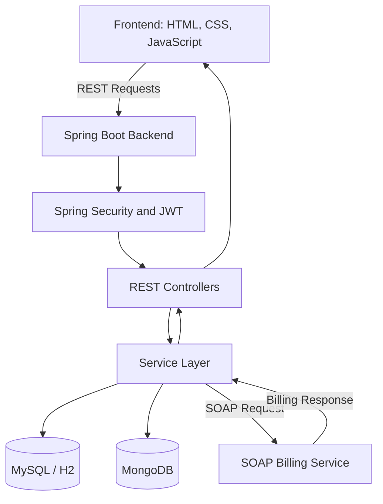

# 🍽️ BiteBliss — Online Food Ordering System

<p align="center">
  <strong>A Full-Stack Food Ordering Platform with Smart Bill Splitting and Automated Billing</strong>
</p>

<p align="center">
  Built as part of the API & Microservices course project  
  Department of Artificial Intelligence and Machine Learning  
  Aditya University
</p>

---

## 📌 Project Overview

**BiteBliss** is a full-stack online food ordering platform designed to make food discovery, ordering, billing, and order tracking convenient for customers.

The application allows users to explore food categories, search for dishes, manage their shopping cart, apply coupon discounts, place orders, and monitor order status. A key feature is the **Smart Group Bill Splitter**, which helps friends divide a bill equally or according to individual food items.

The backend is built with Java and Spring Boot, exposing REST APIs for application operations and integrating a SOAP-based billing service. The application uses relational storage for structured transactional data and MongoDB for document-oriented data such as order snapshots, reviews, and activity logs.

## ✨ Key Features

- **Food Discovery:** Browse food categories, search dishes, filter results, and explore offers.
- **Cart Management:** Add, update, and remove food items and provide special cooking instructions.
- **Coupon Management:** Apply eligible coupons and calculate updated discounts.
- **Order Management:** Create orders, retrieve order details, update order information, and manage order status.
- **Smart Bill Splitting:** Split bills equally or by individual items, manage participants, and view each person's share.
- **Billing and Invoices:** Integrate billing operations through a SOAP service.
- **Order Tracking:** Display order confirmation, status stages, order history, and invoice details.
- **Authentication and Authorization:** JWT-based authentication with Customer and Admin roles.
- **Admin Dashboard:** Manage menu items and monitor order and business statistics.
- **Application Reliability:** Input validation, centralized exception handling, transaction management, and AOP request logging.

## 🛠️ Technology Stack

| Layer | Technologies |
|---|---|
| Frontend | HTML5, CSS3, JavaScript (ES6+) |
| Backend | Java 17, Spring Boot 3 |
| Security | Spring Security, JWT |
| REST APIs | Spring Web |
| Relational Database | MySQL 8.x / H2 |
| Document Database | MongoDB 8.x |
| Persistence | Spring Data JPA, Spring Data MongoDB |
| SOAP Integration | Spring Web Services (Spring-WS) |
| Build Tool | Apache Maven |
| Containerization | Docker, Docker Compose |
| Deployment | Render / Railway (configuration-dependent) |

## 🏗️ System Architecture



### Order Processing Workflow

1. The customer accesses the application and browses the food menu.
2. The customer selects food items and quantities.
3. Selected items are added to the cart.
4. The customer reviews the bill and applies eligible coupons.
5. The frontend submits an order request to the backend.
6. The backend validates the order details and processes the required operations.
7. The billing service handles the billing request through SOAP integration.
8. The system returns the relevant response and displays order information to the customer.

## 👩‍💻 My Contribution

**Contributor: O. Bheemeswari**  
**Role: Backend Development**

My contribution focuses on the backend functionality of the BiteBliss application, particularly the APIs and supporting services required for food ordering and billing.

### Responsibilities

- **REST API Development:** Develop and maintain backend endpoints for application operations.
- **Order Management:** Support order creation, retrieval, updates, cancellation, and status handling.
- **Request Validation:** Validate incoming data and handle invalid requests appropriately.
- **Transaction Management:** Support reliable order processing and data consistency.
- **SOAP Billing Integration:** Work on the integration between order processing and the billing service.
- **Database Integration:** Work with relational and document databases according to the application's data requirements.
- **Exception Handling and Logging:** Support error handling and application request logging.
- **API Testing and Debugging:** Verify endpoint behavior and troubleshoot backend issues.

*Note: The responsibilities above describe the intended contribution areas. Retain only the tasks you personally implemented, tested, or maintained.*

## 🗄️ Database Design

The application uses a polyglot persistence approach.

### Relational Database — MySQL / H2

Used for structured data requiring relational consistency, such as:

- User and authentication data
- Addresses and coupons
- Other relational application records

### MongoDB

Used for document-oriented data, including:

- Order snapshots
- Customer reviews
- Application activity logs
- Group-splitting details where supported by the implementation

The actual collections and database configuration depend on the environment and the current repository implementation.

## 📡 API Reference

The backend exposes REST endpoints for application operations.

### MongoDB-Related Endpoints

| Method | Endpoint | Purpose |
|---|---|---|
| GET | `/api/mongo/status` | Check MongoDB connection and collection status |
| GET | `/api/mongo/orders` | Retrieve order documents |
| GET | `/api/mongo/orders/user/{userId}` | Retrieve orders associated with a user |
| GET | `/api/mongo/reviews` | Retrieve customer reviews |
| GET | `/api/mongo/activity` | Retrieve application activity logs |
| POST | `/api/mongo/activity` | Record an activity log entry |

Protected endpoints require a valid JWT in the request header:

```http
Authorization: Bearer <JWT>
```

Order and menu APIs also support order operations and menu pagination, according to the implemented routes.

## 🚀 Getting Started

### Prerequisites

Install the following tools before running the project:

- Java 17 or later
- Apache Maven 3.6 or later
- MySQL 8.x or the configured H2 database
- MongoDB 8.x or a MongoDB Atlas connection
- Git

### 1. Clone the Repository

```bash
git clone https://github.com/Hasini2706/BiteBliss.git
cd BiteBliss
```

### 2. Configure the Backend

Configure the database connection and application settings in the backend configuration files or environment variables.

For MongoDB, the local development URI may be:

```text
mongodb://localhost:27017/bitebliss
```

Use your configured MySQL or H2 settings for relational storage.

Do not commit real passwords, database credentials, JWT secrets, or production environment variables to GitHub.

### 3. Build and Run the Backend

```bash
cd backend
mvn clean install
mvn spring-boot:run
```

The backend is configured to run on port `8080` by default in the documented setup. Check your application configuration if it uses a different port.

### 4. Run the Frontend

Open `frontend/index.html` in a browser, or use a local static server:

```bash
cd frontend
python -m http.server 5500
```

Then open:

```text
http://localhost:5500
```

Make sure the frontend's configured backend URL matches the port where Spring Boot is running.

### 5. Run with Docker Compose

If the repository contains a valid Docker Compose configuration:

```bash
docker compose up -d --build
```

Check the Compose configuration for the correct service ports and environment variables.

## 🧪 Testing

Backend functionality can be verified by testing:

- REST API request and response behavior
- Order creation and update operations
- Menu retrieval and pagination
- Validation and exception responses
- Coupon and bill calculations
- Database connectivity
- SOAP billing request and response handling
- Authentication and authorization

Use the repository's configured test framework and API testing tools to verify the implemented behavior.

## 🔐 Demo Credentials

If the repository includes demo accounts, use the credentials configured for your local environment.

Do not publish working production credentials or real user information in this section. Change sample passwords and secrets before exposing a deployment publicly.

## 🗺️ Future Enhancements

- Online payment gateway integration
- Live GPS-based delivery tracking
- Delivery partner management
- Personalized food recommendations
- Order and delivery notifications
- Restaurant-side menu management
- Loyalty points and reward programs
- Android and iOS mobile applications

## 👥 Team

**Project:** BiteBliss — Online Food Ordering System  
**Course:** API & Microservices  
**Department:** Artificial Intelligence and Machine Learning  
**Institution:** Aditya University

### Contributors

- K. Swarna
- K. Sasi Meghana
- M. Tejo Hasini
- O. Bheemeswari — Backend Development

## 📄 License

This project was developed for academic purposes as part of the API & Microservices course. Add a license file if the team intends to distribute the project under a specific open-source license.

---

<p align="center">
  <strong>BiteBliss — Good Food. Better Mood.</strong>
</p>
