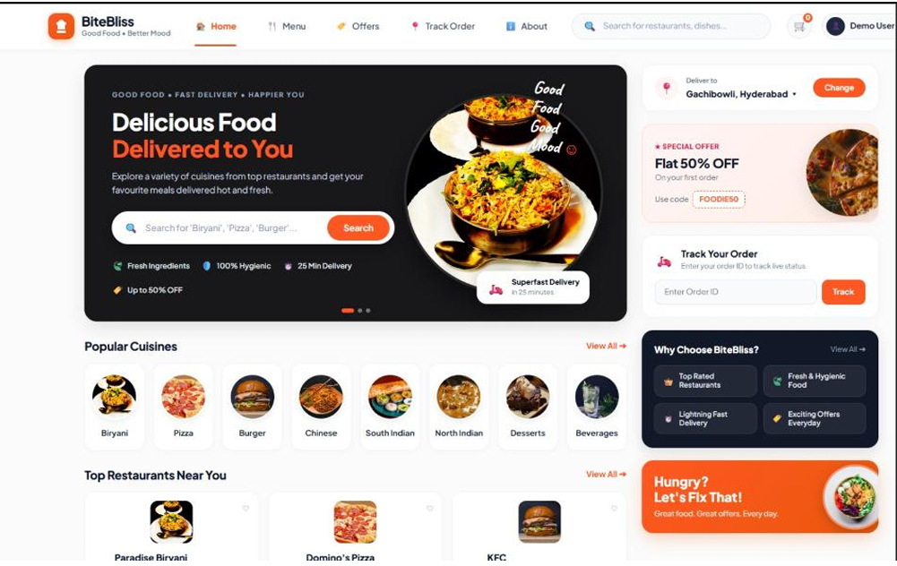
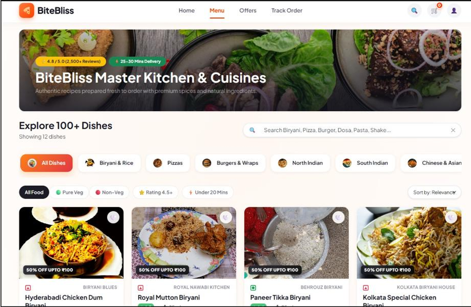
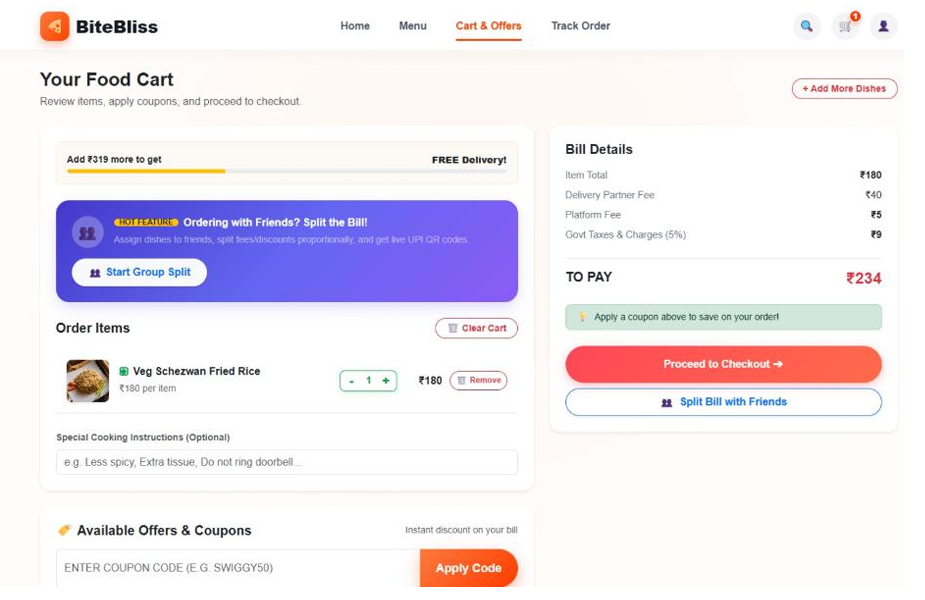
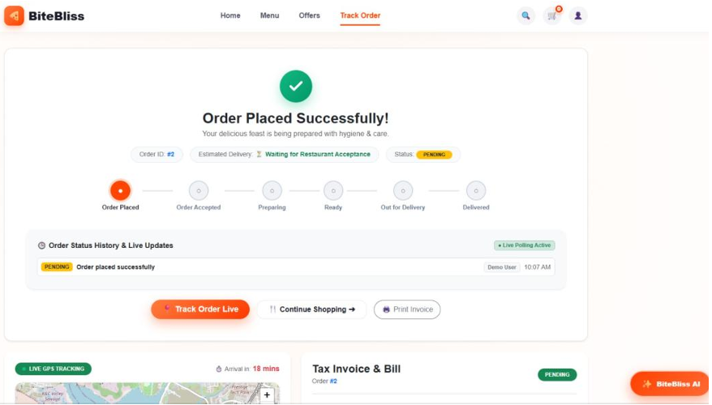
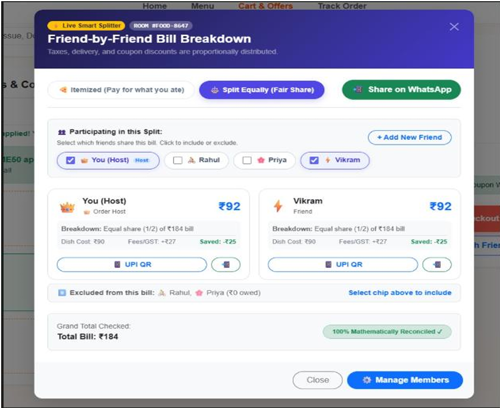
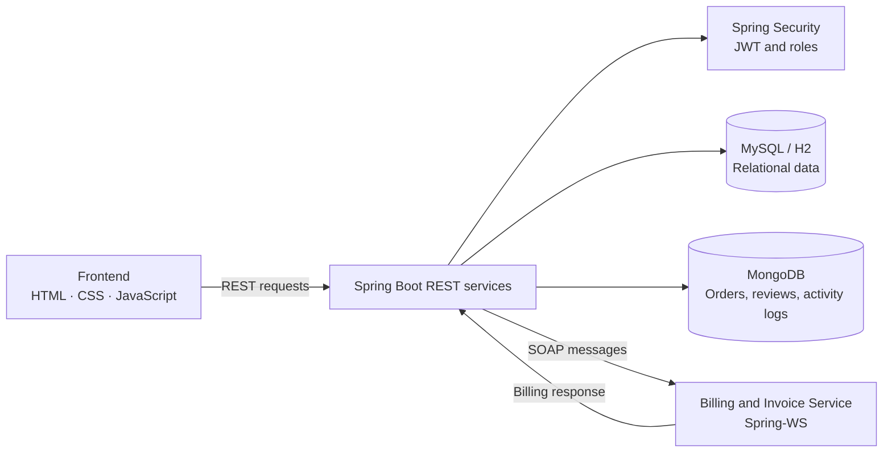

<div align="center">

# 🍽️ BiteBliss

### Online Food Ordering System

**Discover food, manage orders, apply coupons, and split a bill with friends.**

<p>
  
  
  
  
  
  
</p>

<p><em>API &amp; Microservices Course Project · Batch 21</em></p>
<p><strong>Department of Artificial Intelligence and Machine Learning · Aditya University</strong></p>



</div>

---

## 📌 Project Overview

**BiteBliss** is a full-stack food ordering platform designed to make food discovery and order management convenient. Customers can browse food categories, search for dishes, manage a cart, apply coupon codes, review bill details, track order status, and split a bill with friends.

The project is developed for the **API & Microservices** course. Its documented backend stack includes Java 17, Spring Boot 3, REST APIs, JWT-based security, relational persistence, MongoDB, and a SOAP-based billing service.

> **Implementation note:** The README reflects the supplied project description and screenshots. Check the current source code and configuration before treating an endpoint, integration, or deployment option as available in every environment.

## 📑 Contents

- [Key Features](#-key-features)
- [Screenshots](#-screenshots)
- [System Architecture](#-system-architecture)
- [Technology Stack](#️-technology-stack)
- [My Contribution](#-my-contribution)
- [Getting Started](#-getting-started)
- [API Reference](#-api-reference)
- [Deployment](#️-deployment)
- [Troubleshooting](#-troubleshooting)
- [Future Enhancements](#-future-enhancements)
- [Team](#-team)

## 🌟 Key Features

| Module | Description |
|---|---|
| **Home & Restaurant Discovery** | Browse popular cuisines, explore restaurants and offers, search for dishes, and view order-tracking entry points. |
| **Menu & Food Management** | Browse food categories, search dishes, apply food filters, sort results, and use menu pagination where configured. |
| **Cart & Order Management** | Add or remove items, adjust quantities, enter special cooking instructions, and review items before checkout. |
| **Coupon Management** | Enter coupon codes, view eligibility feedback, apply discounts, and review the updated bill. |
| **Billing Details** | Review item totals, delivery fees, platform fees, taxes, discounts, and the total payable amount. |
| **Smart Group Bill Splitter** | Add or select friends, split the bill equally or by item, view individual shares, and access UPI QR and share options. |
| **Order Tracking** | View order confirmation, order ID, order stages, status history, estimated delivery information, and invoice details as supported by the configured app. |
| **Security & Admin** | The project description includes JWT authentication with Customer and Admin roles, plus menu and order management in the admin dashboard. |
| **Backend Reliability** | The project description includes transaction management, AOP request logging, validation, centralized exception handling, and SOAP billing integration. |

## 📸 Screenshots

These are **actual BiteBliss interface screenshots supplied for the project**, referenced with relative paths so GitHub can render them after the image files are committed to the repository.

### Home and Menu

<table>
  <tr>
    <td width="50%"><strong>Home page</strong><br/></td>
    <td width="50%"><strong>Menu</strong><br/></td>
  </tr>
</table>

### Cart and Coupons

<table>
  <tr>
    <td width="50%"><strong>Cart and bill details</strong><br/></td>
    <td width="50%"><strong>Coupon application</strong><br/></td>
  </tr>
</table>

### Order Tracking and Group Bill Splitting

<table>
  <tr>
    <td width="50%"><strong>Order tracking</strong><br/></td>
    <td width="50%"><strong>Group bill splitter</strong><br/></td>
  </tr>
</table>

## 🧭 System Architecture



### High-level order workflow

1. The customer opens BiteBliss and browses the menu.
2. The customer searches for dishes and selects items and quantities.
3. Selected items are added to the cart.
4. The customer reviews the bill and applies an eligible coupon, if available.
5. The frontend sends the appropriate request to the backend.
6. The backend validates the request and processes the required order operations.
7. The billing service handles billing through SOAP where that integration is configured.
8. The application displays the order result and relevant tracking details.

### Database approach

The supplied project description documents two storage types:

- **Relational database (MySQL / H2):** structured records such as users, authentication data, addresses, and coupons.
- **MongoDB:** document-oriented data such as order snapshots, reviews, and activity logs.

The exact database and active collections depend on the selected application profile and configuration.

## 🛠️ Technology Stack

| Layer | Technology |
|---|---|
| Frontend | HTML5, CSS3, JavaScript (ES6+) |
| Backend | Java 17, Spring Boot 3 |
| API layer | Spring Web / REST |
| Security | Spring Security, JWT |
| Relational persistence | Spring Data JPA, MySQL 8.x or H2 |
| Document persistence | Spring Data MongoDB, MongoDB 8.x |
| Billing integration | Spring Web Services (SOAP) |
| Build | Apache Maven |
| Containerization | Docker, Docker Compose |
| Deployment options in project notes | Render / Railway, depending on configuration |

## 👩‍💻 My Contribution

**Contributor:** O. Bheemeswari  
**Role:** Backend Development  
**Project:** BiteBliss — Online Food Ordering System  
**Student ID:** 24B11AI305

My assigned role in BiteBliss is backend development. My contribution focuses on the server-side APIs and service integration needed to support the food ordering workflow.

Areas associated with my role include:

- **REST API development:** Implementing or maintaining API endpoints used by the frontend.
- **Order processing:** Supporting order creation, retrieval, updates, cancellation, and status operations where implemented.
- **Validation and error handling:** Validating request data and providing meaningful error responses.
- **Transaction handling:** Supporting consistent processing of order-related operations.
- **SOAP billing integration:** Integrating the ordering workflow with the billing service where implemented.
- **Database integration:** Working with configured relational and document databases.
- **Logging and debugging:** Supporting application logging and investigating backend/API issues.
- **Testing:** Checking API requests, responses, and integration behavior.

> Update this section to list only the tasks you personally implemented, tested, or maintained. Team-level features should not be described as your individual contribution unless you worked on them.

## 🚀 Getting Started

### Prerequisites

- Java 17 or later
- Apache Maven 3.6 or later
- MySQL 8.x or the configured H2 database
- MongoDB local instance or MongoDB Atlas URI, if MongoDB is enabled
- Git

### 1. Clone the repository

```bash
git clone https://github.com/Hasini2706/BiteBliss.git
cd BiteBliss
```

### 2. Configure the backend

Configure database connections, JWT settings, service ports, and SOAP billing properties through the application's configuration files or environment variables. Do not commit production secrets, real passwords, tokens, or database credentials.

Example local MongoDB URI from the project notes:

```text
mongodb://localhost:27017/bitebliss
```

### 3. Build and run the backend

```bash
cd backend
mvn clean install
mvn spring-boot:run
```

The project notes list port `8080` as the default backend port, with `8081` used in some configurations. Check the active configuration if the application uses another port.

### 4. Run the frontend

Open `frontend/index.html` in a browser, or serve the folder locally:

```bash
cd frontend
python -m http.server 5500
```

Then open `http://localhost:5500`. Make sure the frontend API base URL matches the backend port.

### 5. Run with Docker Compose

If the repository's Compose configuration is present and configured:

```bash
docker compose up -d --build
```

Check exposed ports and required environment variables in the Compose file.

## 📡 API Reference

The supplied project notes list these MongoDB-related routes. Confirm the exact route definitions and security requirements against the current backend source code.

| Method | Endpoint | Purpose |
|---|---|---|
| `GET` | `/api/mongo/status` | Check MongoDB connectivity and reported collection status |
| `GET` | `/api/mongo/orders` | Retrieve order documents |
| `GET` | `/api/mongo/orders/user/{userId}` | Retrieve orders for a user |
| `GET` | `/api/mongo/reviews` | Retrieve customer reviews |
| `GET` | `/api/mongo/activity` | Retrieve activity-log entries |
| `POST` | `/api/mongo/activity` | Record an activity-log entry |

Example status check when the backend is running on port 8080:

```bash
curl http://localhost:8080/api/mongo/status
```

The project description also refers to order creation, retrieval, updating, cancellation, and menu pagination. Consult the relevant controllers for exact endpoint paths and request/response formats.

Protected endpoints may require a JWT authorization header, depending on the configured security rules:

```http
Authorization: Bearer <JWT>
```

## ☁️ Deployment

The project notes describe Render or Railway deployment and Docker Compose for containerized runs. Deployment commands, output JAR names, ports, and environment variables must match the checked-in backend and Compose configuration.

General deployment checklist:

1. Push the project to GitHub.
2. Connect the repository to the chosen hosting platform.
3. Select Docker or the appropriate Java/Maven runtime.
4. Configure the build and start commands for the actual backend artifact.
5. Add required database URIs and environment variables through the platform's settings.
6. Deploy and verify the frontend, REST APIs, database connections, and billing integration.

Do not store credentials directly in the repository or README.

## 🩺 Troubleshooting

| Problem | Things to check |
|---|---|
| Backend cannot connect to MongoDB | Confirm MongoDB is running and verify the connection URI. |
| MySQL connection error | Check service availability, credentials, database name, and the active profile. |
| Port already in use | Stop the conflicting process or update the configured port. |
| Frontend loads but no data appears | Confirm the backend is running and the frontend API URL is correct. |
| SOAP billing call fails | Check the billing service URL, SOAP configuration, and backend logs. |
| Protected endpoint rejects the request | Verify token validity and the configured access rules. |

## 🗺️ Future Enhancements

Potential future enhancements include:

- [ ] Online payments through UPI, cards, and wallets
- [ ] Live GPS delivery tracking and delivery-partner management
- [ ] Personalized food recommendations
- [ ] Order, billing, and delivery notifications
- [ ] Restaurant-side menu and availability management
- [ ] Loyalty points, personalized coupons, and rewards
- [ ] Android and iOS applications

## 👥 Team

**Course:** API & Microservices  
**Department:** Artificial Intelligence and Machine Learning  
**Institution:** Aditya University  
**Batch:** 21

- K. Swarna — `24B11AI151`
- K. Sasi Meghana — `24B11AI194`
- M. Tejo Hasini — `24B11AI223`
- O. Bheemeswari — `24B11AI305` · Backend Development

---

<p align="center">
  <strong>BiteBliss — Good Food. Better Mood.</strong><br/>
  Built for convenient food ordering and fair bill splitting.
</p>
